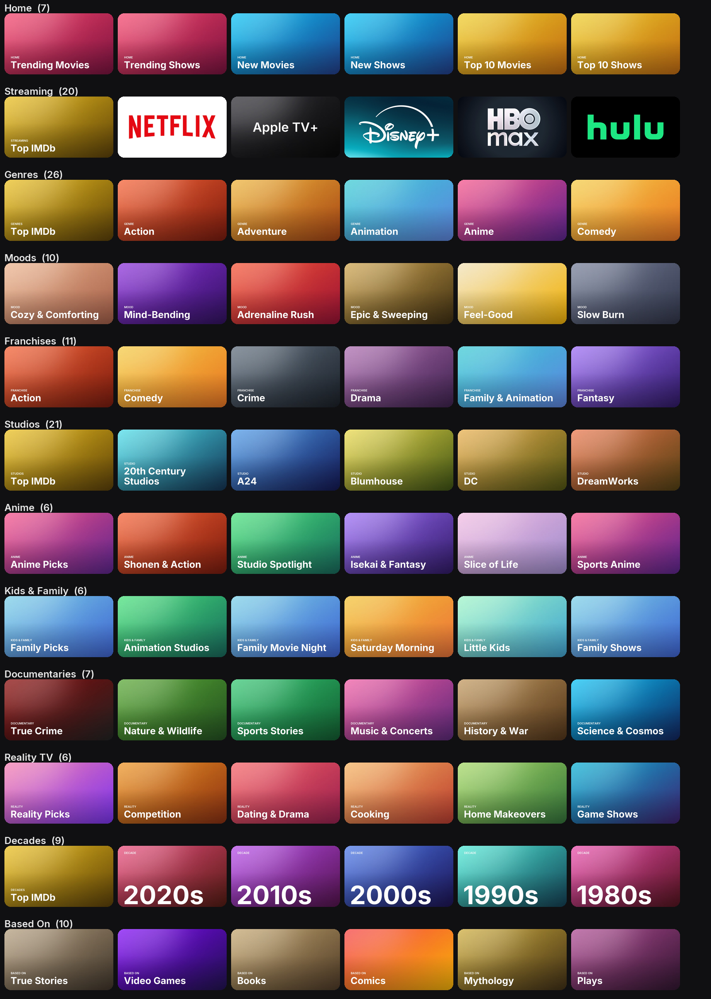

# nuvio-tvos-art

Cover art for a personal Nuvio / BingeCat collection pack, styled after the Apple TV app:
one consistent look for every folder tile.

- `covers/*.jpg` - 1280x720 folder covers, referenced by URL from the collection JSON
  (`https://raw.githubusercontent.com/bennyftw32/nuvio-tvos-art/main/covers/<file>`).
- Gradient tiles are generated (Inter typeface, SIL OFL 1.1).
- Streaming-service tiles use each service's Apple TV (tvOS) app icon as published on the
  App Store. Those logos are trademarks of their owners and are used here only to label
  the matching folder.

Not affiliated with Apple, IMDb, Nuvio, BingeCat, or any streaming service.
