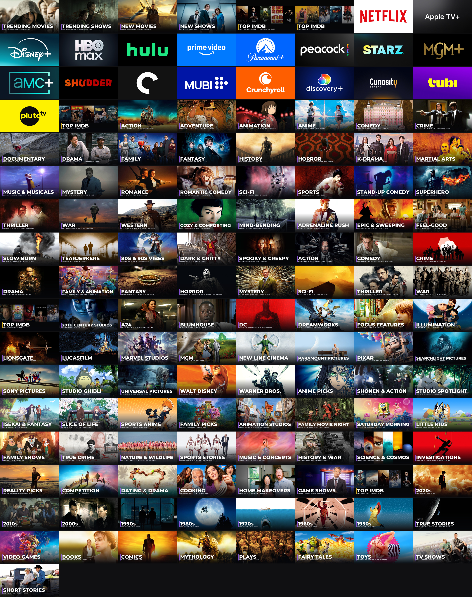

# nuvio-tvos-art

Cover art for a personal Nuvio / BingeCat collection pack.

- `v2/covers/*.jpg` - current 1280x720 folder covers: a film/show still per folder with a
  heavy caps title and tagline (Montserrat, SIL OFL 1.1). Stills are TMDB backdrops; Top IMDb
  tiles are posters of the top-rated titles. Referenced from the collection JSON as
  `https://raw.githubusercontent.com/bennyftw32/nuvio-tvos-art/main/v2/covers/<file>`.
- Streaming-service tiles use each service's Apple TV (tvOS) app icon from the App Store.
- `covers/` - the earlier gradient-style set (superseded).

Film/show images and logos belong to their respective owners and are used here only to label
the matching folder. This product uses the TMDB API but is not endorsed or certified by TMDB.
Not affiliated with Apple, IMDb, Nuvio, BingeCat, or any studio or streaming service.
